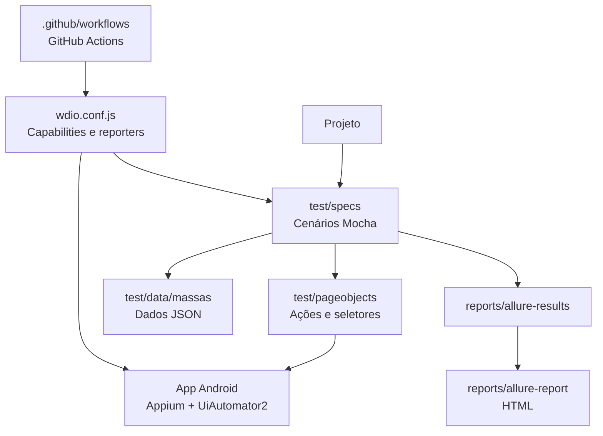

# 📱 Mobile Automation | WebdriverIO + Appium

Automação de testes de interface Android com WebdriverIO, Appium, Mocha e Allure Report. O projeto exercita fluxos de autenticação e componentes de formulário no app de demonstração nativo do WebdriverIO, tanto em emulador local quanto no GitHub Actions.

[Repositório](https://github.com/FelipePatrocinioQa/desafio-automacao-mobile) · [Execuções do CI](https://github.com/FelipePatrocinioQa/desafio-automacao-mobile/actions) · [Baixar o app Android](https://github.com/webdriverio/native-demo-app/releases/download/v2.2.0/android.wdio.native.app.v2.2.0.apk)

## 🧭 Navegação

[Visão geral](#visão-geral) · [Estrutura](#estrutura-do-projeto) · [Pré-requisitos](#pré-requisitos) · [Configuração](#configuração-local-windows) · [Testes](#cenários-automatizados) · [Relatórios](#relatórios-allure) · [CI](#integração-contínua)

---

## ✨ Visão geral

O projeto reúne dez cenários automatizados, Page Objects, dados externos em JSON e evidências Allure. Os cadastros válidos usam e-mail único gerado durante a execução, evitando colisões entre execuções sucessivas.

## 🧰 Tecnologias e documentação

- [Node.js LTS](https://nodejs.org/en/download)
- [Java JDK 17 (Eclipse Temurin)](https://adoptium.net/temurin/releases/?version=17)
- [Android Studio e Android SDK](https://developer.android.com/studio)
- [Appium](https://appium.io/docs/en/latest/)
- [Driver UiAutomator2](https://appium.github.io/appium.io/docs/en/drivers/android-uiautomator2/)
- [WebdriverIO](https://webdriver.io/docs/gettingstarted)
- [Allure Report](https://allurereport.org/docs/)

O Appium CLI e o driver UiAutomator2 são instalados como dependências do projeto; não é necessário instalar o Appium globalmente.

---

## 🗂️ Estrutura do projeto

```text
desafio-automacao-mobile/
├── .github/
│   └── workflows/
│       └── mobile-tests.yml
├── reports/                    # relatórios gerados localmente (ignorados pelo Git)
├── test/
│   ├── data/
│   │   └── massas/
│   │       ├── login.json
│   │       ├── cadastro.json
│   │       └── formulario.json
│   ├── pageobjects/
│   │   ├── FormPage.js
│   │   ├── LoginPage.js
│   │   └── BasePage.js
│   └── specs/
│       └── desafio-mobile.spec.js
├── .gitignore
├── package.json
├── package-lock.json
├── wdio.conf.js
└── README.md
```

### Como as partes se conectam



GitHub renderiza este diagrama diretamente no README. A árvore abaixo mostra os principais arquivos versionados; `reports/` é criado durante a execução e fica fora do Git.

### Responsabilidade das pastas

- `.github/workflows/`: pipeline Android no GitHub Actions
- `test/data/massas/`: entradas de teste em JSON
- `test/pageobjects/`: seletores e ações reutilizáveis das telas
- `test/specs/`: cenários e validações
- `wdio.conf.js`: capabilities, conexão Appium e reporter Allure
- `reports/`: resultados brutos e relatório HTML gerados localmente

---

## ✅ Pré-requisitos

Antes de executar o projeto, verifique se os itens abaixo estão instalados:

### Node.js LTS e Java 17
```bash
node -v
npm -v
java -version
```

### Android Studio e SDK

Instale pelo Android Studio o Android SDK, Platform Tools, Emulator e uma imagem de sistema para API 37 (execução local padrão). O workflow do GitHub usa API 34.

```powershell
$env:LOCALAPPDATA\Android\Sdk
```

Além disso, confirme que os tools abaixo estejam disponíveis:
```powershell
adb version
emulator -list-avds
```

Confirme que `adb` e `emulator` estão no `PATH`:
```powershell
adb version
emulator -list-avds
```

---

## ⚙️ Variáveis de ambiente

O WDIO aceita o caminho do APK e os dados do dispositivo via variáveis de ambiente. Os valores padrão são para o emulador local; o workflow define os valores próprios do runner.

## Configuração local (Windows)

### 1. Configure as variáveis no PowerShell

Atualize o caminho de `JAVA_HOME` para a pasta do JDK instalado. Estas definições valem para o terminal atual. No PowerShell, use `npm.cmd` para evitar bloqueios de execução do shim `npm.ps1`:

```powershell
$env:ANDROID_HOME = "$env:LOCALAPPDATA\Android\Sdk"
$env:ANDROID_SDK_ROOT = "$env:LOCALAPPDATA\Android\Sdk"
$env:JAVA_HOME = "C:\Program Files\Eclipse Adoptium\jdk-17"
$env:DEMO_APP_APK = "$env:USERPROFILE\Downloads\android.wdio.native.app.v2.2.0.apk"

$env:Path += ";$env:ANDROID_HOME\platform-tools;$env:ANDROID_HOME\emulator;$env:JAVA_HOME\bin"
```

Baixe o APK oficial para o caminho configurado:

```powershell
Invoke-WebRequest `
  -Uri "https://github.com/webdriverio/native-demo-app/releases/download/v2.2.0/android.wdio.native.app.v2.2.0.apk" `
  -OutFile $env:DEMO_APP_APK
```

Variáveis disponíveis: `ANDROID_HOME`, `ANDROID_SDK_ROOT`, `JAVA_HOME`, `DEMO_APP_APK`, `ANDROID_DEVICE_NAME`, `ANDROID_UDID` e `ANDROID_PLATFORM_VERSION`. `ANDROID_DEVICE_NAME`, `ANDROID_UDID` e `ANDROID_PLATFORM_VERSION` são opcionais; os padrões locais estão em `wdio.conf.js`.

### 2. Instale as dependências e o driver Appium

```powershell
npm.cmd ci
npx appium driver install uiautomator2
```

### 3. Inicie e valide o emulador
```powershell
& "$env:LOCALAPPDATA\Android\Sdk\emulator\emulator.exe" -list-avds
& "$env:LOCALAPPDATA\Android\Sdk\emulator\emulator.exe" -avd Medium_Phone_API_37.0
adb devices
adb -s emulator-5554 wait-for-device
adb -s emulator-5554 shell getprop sys.boot_completed
```

Espere o Android terminar de inicializar; `sys.boot_completed` deve retornar `1`.

### 4. Inicie o Appium e rode a suíte

Em um segundo terminal, inicie o servidor:
```powershell
npx appium --port 4723
```

Confira o status e, em outro terminal, execute os testes:
```powershell
Invoke-RestMethod http://127.0.0.1:4723/status
npm.cmd test
```

## 🧪 Cenários automatizados

| # | Cobertura |
|---|---|
| 01 | Login com credenciais válidas |
| 02 | Validação de e-mail inválido |
| 03 | Validação de senha curta |
| 04 | Cadastro válido com e-mail único |
| 05 | Validação de confirmação de senha divergente |
| 06 | Exibição do texto digitado |
| 07 | Limite de 30 caracteres no campo |
| 08 | Alternância do switch e atualização da mensagem |
| 09 | Seleção de opção no dropdown |
| 10 | Alerta do botão ativo |

Execute todos os cenários com `npm.cmd test`. Para filtrar um teste pelo título, use o runner do Mocha via WDIO:

```powershell
npm.cmd test -- --mochaOpts.grep "login com credenciais válidas"
```

---

## 📊 Relatórios Allure

O reporter grava os resultados brutos em `reports/allure-results`. O relatório HTML é gerado separadamente:

### Gerar o relatório HTML
```powershell
cd C:\WorkSpace\Repositorios\desafio-automacao-mobile
npm.cmd run report
```

### Abrir o relatório localmente
```powershell
npm.cmd run report:open
```

Depois acesse:
```text
O Allure inicia um servidor local e abre o relatório no navegador. Não abra `index.html` diretamente como arquivo.
```

---

### Comando integrado no Windows

O script abaixo limpa os resultados antigos, executa a suíte, gera o HTML e abre o relatório. Requer PowerShell:

```powershell
npm.cmd run test:report
```

Os scripts `test`, `test:spec`, `report` e `report:open` também estão disponíveis individualmente no [package.json](package.json).

---

## 🧾 Dados de teste (data-driven)

Os dados dos testes ficam em arquivos JSON dentro de `test/data/massas/`, e são importados diretamente pela suíte.

Exemplo:
- `login.json`
- `cadastro.json`
- `formulario.json`

Esse padrão permite:
- reutilizar massas em vários cenários
- alterar dados sem mexer no código de automação
- executar cenários com diferentes entradas

---

## 🤖 Integração contínua

O workflow [mobile-tests.yml](.github/workflows/mobile-tests.yml) roda em pull requests, pushes para `main`/`master` e manualmente. Ele configura Node.js e Java, inicia um emulador Android API 34, instala Appium/UiAutomator2, baixa o APK e executa a suíte. O relatório Allure é publicado como artefato mesmo quando os testes falham.

Na execução local, o WDIO usa por padrão o emulador Android API 37. O workflow informa `ANDROID_PLATFORM_VERSION=34` para corresponder ao emulador de CI; isso evita divergência entre a capability solicitada e o dispositivo real.

## 💡 Diferenciais técnicos

- Page Object Model separa interação com a tela da lógica dos cenários.
- Massas JSON mantêm dados fora dos testes e tornam os fluxos fáceis de revisar.
- Cadastro com e-mail único permite repetir a suíte sem colisões de usuário.
- Screenshots em falhas e relatório Allure facilitam a análise de regressões.
- GitHub Actions valida PRs em emulador Android e publica relatório como artefato.

## 🔎 Diagnóstico rápido

- `adb devices` não lista o emulador: confirme o AVD e aguarde o boot completo (`sys.boot_completed` deve ser `1`).
- Erro ao criar sessão: confira o status do Appium em `http://127.0.0.1:4723/status` e se a versão Android configurada corresponde ao emulador.
- App não encontrado: confira se `DEMO_APP_APK` aponta para o APK baixado.
- `npm ci` falha: confirme que `package-lock.json` está presente e versionado.
- `npm.cmd ci` falha: confirme que `package-lock.json` está presente e versionado.
- Falha no GitHub Actions: abra o job em [Actions](https://github.com/FelipePatrocinioQa/desafio-automacao-mobile/actions) e consulte a primeira etapa com erro.


